# Operating Systems — Worksheet 1

## Setup

### Creating the file structure

The worksheet explains how the project directories should be organised. It states that I should create a folder named `src` containing `asm_io.inc` and `asm_io.asm`, as well as to create the files `driver.c` and `task1.asm` for the upcoming task.

The files `asm_io.inc` and `asm_io.asm` were provided in Learning Unit 2 on Blackboard and contain the pre-written code required.

## Task 1.1

### Creating the code

The worksheet instructed me to add the following code to `driver.c`:

```c
int __attribute__((cdecl)) asm_main(void);

int main(void) {
    int ret_status;
    ret_status = asm_main();
    return ret_status;
}
```

The instructions also referred me to slide 18 of the Learning Unit 2 materials on Blackboard:

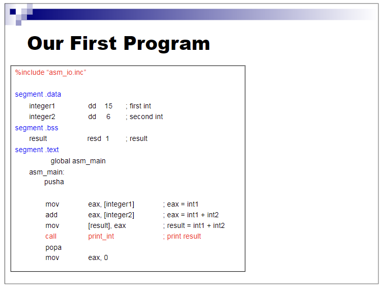

I implemented the example in `task1.asm` and changed the values to demonstrate a variation.

### Assembling, compiling and running the code

Following the worksheet instructions, I assembled the assembly files and compiled the C driver:

```sh
nasm -f elf task1.asm -o task1.o
nasm -f elf asm_io.asm -o asm_io.o
gcc -m32 -c driver.c -o driver.o
```

I then linked the object files to create an executable:

```sh
gcc -m32 driver.o task1.o asm_io.o -o task1
```

Finally, I ran the program:

```sh
./task1
```

The program printed the result:

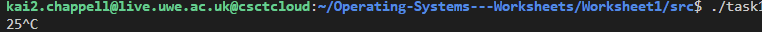

## Task 1.2

### Creating and compiling the new code

The worksheet referred me to slide 22 of the same Learning Unit 2 materials. It instructed me to follow the same process, use the new code from the slide, and create a file named `task1_2.asm`:

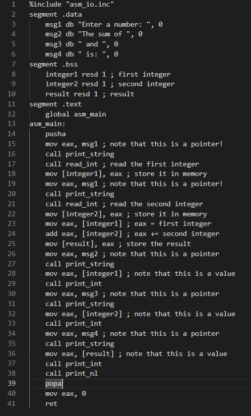

I assembled `task1_2.asm`, then linked it with the existing driver and I/O object files to create a separate executable:

```sh
nasm -f elf task1_2.asm -o task1_2.o
gcc -m32 driver.o task1_2.o asm_io.o -o task1_2
```

The terminal commands are shown below:

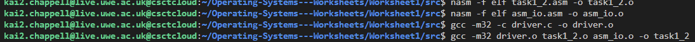

I ran the executable with `./task1_2`. It asked for two numbers and displayed their sum:

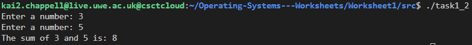

## Task 2

The task asked me to write two assembly programs: one that asks for the user's name and a repetition count, validates the count, and prints a welcome message; and another that fills an array with the numbers 1 to 100, sums them, and displays the result. A later extension to Task 2.2 asked me to update the array program so that the user could enter a range to sum.

### Task 2.1 — Welcome message and input validation

#### Developing the program

I started by defining the prompt and message strings in the `.data` segment. In the `.bss` segment, I reserved space for the user's name and for the remaining number of welcome messages.

I then wrote the program to:

1. Display a prompt and read the user's name one character at a time.
2. Store up to 40 characters in the name buffer and add a zero terminator.
3. Ask how many times to print the welcome message and read the number.
4. Check the number against the allowed bounds. If it is outside the range, print the relevant error message.
5. Otherwise, print the welcome message repeatedly, decreasing the remaining count each time.

SIDE NOTE: The current code accepts values from **50 to 99 inclusive**. The task wording says the number should be greater than 50 and less than 100, which would mean **51 to 99**. If the lower bound was meant to be strictly greater than 50, the lower-bound check in `task2_1.asm` will not reject this, but will reject all values below 50.

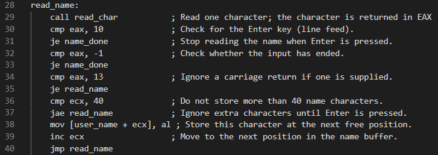

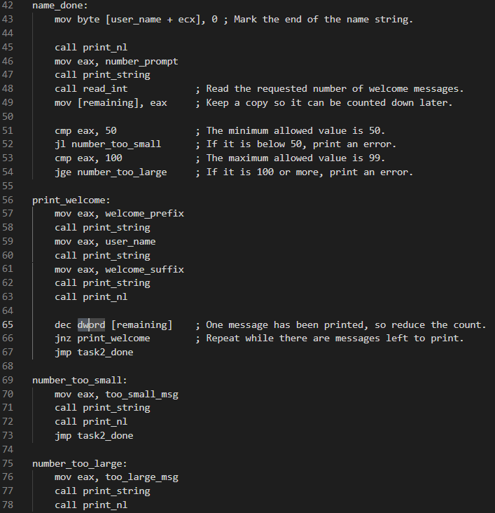

#### Assembling, compiling and running the program

I assembled `task2_1.asm` and linked it with the driver and I/O object files:

```sh
nasm -f elf task2_1.asm -o task2_1.o
gcc -m32 driver.o task2_1.o asm_io.o -o task2_1
```

I ran the program with:

```sh
./task2_1
```

*(The image below proceded to print the welcome message 50 times:)*

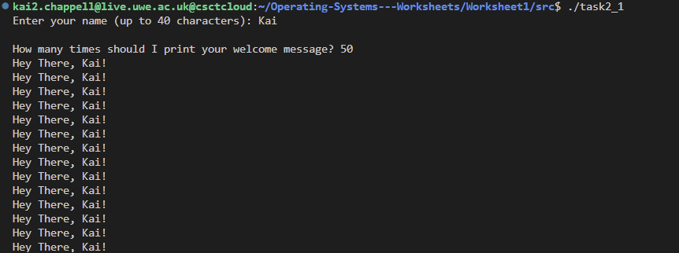

*(The images below show the error handling for values below 50 or above 100)*

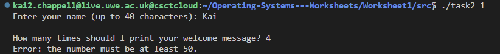

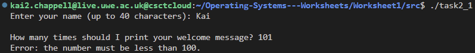

### Task 2.2 — Initialising and summing an array

#### Developing the program

I reserved space for 100 32-bit values in the `.bss` segment, along with a separate location for the running total. I used one loop to initialise the array with the numbers 1 to 100. I then used a second loop to read each array element and add it to the total.

After the loops, the program displays the total. The expected sum of the numbers from 1 to 100 is **5050**.

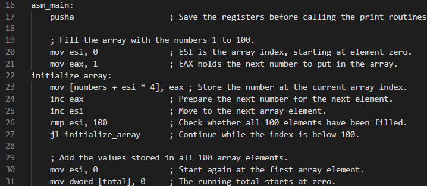

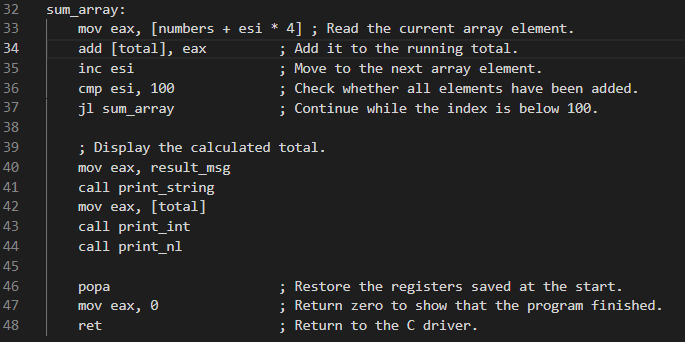

#### Assembling, compiling and running the program

I assembled `task2_2.asm` and linked it with the driver and I/O object files:

```sh
nasm -f elf task2_2.asm -o task2_2.o
gcc -m32 driver.o task2_2.o asm_io.o -o task2_2
```

I then ran the program with:

```sh
./task2_2
```

The program displayed the sum, **5050**:

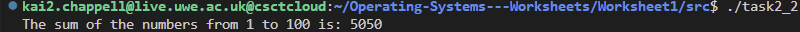

#### Extending the program to sum a user-specified range

The task then extends to ask the user to enter a range to sum, check that the range is valid, and display the sum of that range. I extended `task2_2.asm` to prompt for the first and last numbers after initialising the array. Both endpoints must be between **1 and 100**, and the last number must be greater than or equal to the first. If either endpoint is out of bounds or the last number is less than the first, the program prints an error message.

The range is inclusive. For example, entering `3` and `5` sums the array elements `3`, `4` and `5`, producing **12**. Entering `1` and `100` sums the entire array and produces **5050**. The earlier screenshots above document the original version, before this range-input extension.

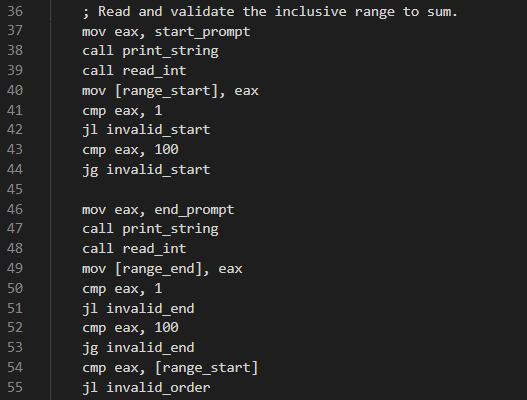

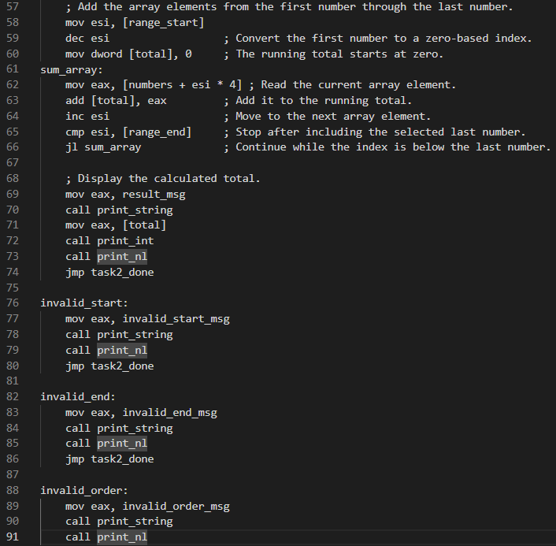

I reassembled and linked the updated program using the same commands:

```sh
nasm -f elf task2_2.asm -o task2_2.o
gcc -m32 driver.o task2_2.o asm_io.o -o task2_2
```

I then ran the updated program with `./task2_2` and checked full, partial, and invalid ranges.

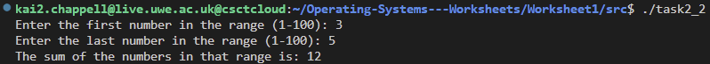

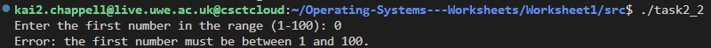

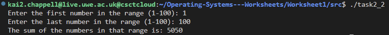

## Task 3 — Building the programs with Make

As the task implies, I created a `Makefile` in the `Worksheet1` folder so the programs could be built in one step. The `all` target builds all four executables, and each program has its own target listing the files it depends on.

In `Makefile`, each target line says what has to be rebuilt. For example, `src/task2_2: src/task2_2.asm src/driver.c src/asm_io.asm src/asm_io.inc` tells `make` that the file depends on those sources. The commands underneath are then run in order: assemble the `.asm` file, compile `driver.c`, assemble the I/O library, and link the final executable. `make` only rebuilds what changed.

Run these commands from the repository root to choose which task to build:

```sh
# Build all four programs
make -C Worksheet1

# Build just one program
make -C Worksheet1 task1
make -C Worksheet1 task1_2
make -C Worksheet1 task2_1
make -C Worksheet1 task2_2
```

The available targets are `task1`, `task1_2`, `task2_1`, and `task2_2`. From inside the `Worksheet1` directory, omit `-C Worksheet1` (for example, run `make task2_2`). After building, run a program from `Worksheet1` with `./src/task2_2`; replace `task2_2` with any of the target you built.
